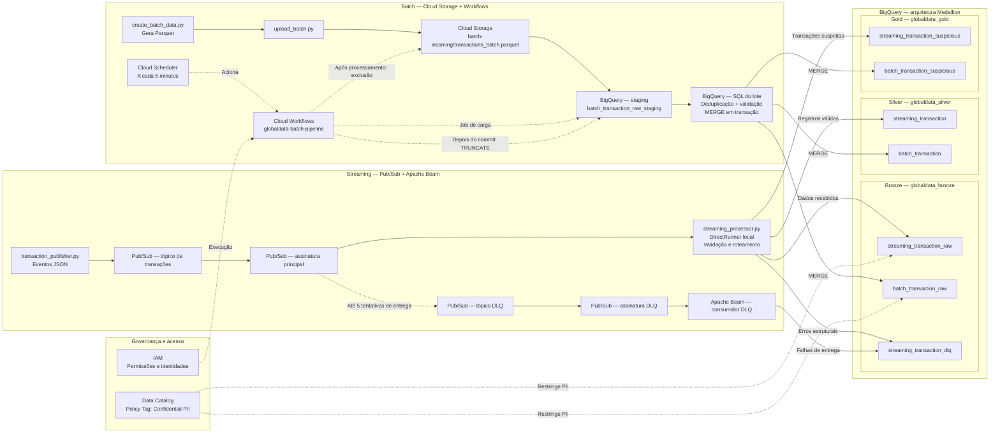

# Arquitetura da solução — GlobalData

## Visão geral

O projeto possui dois pipelines de transações: streaming, com Pub/Sub e Apache Beam, e batch, com arquivos Parquet no Cloud Storage. Os dados são organizados no BigQuery em camadas Bronze, Silver e Gold.



No streaming, o Beam envia os dados diretamente para cada camada do BigQuery. No batch, o processamento é feito com SQL e MERGE, após a carga do arquivo em uma tabela de staging.

## Componentes e escolhas

| Tecnologia | Uso no projeto | Motivo da escolha |
| --- | --- | --- |
| Arquitetura Medallion | Separação entre Bronze, Silver e Gold. | Organiza os dados recebidos, os registros válidos e as transações suspeitas. |
| Pub/Sub | Recebimento das transações em streaming. | Separa a publicação dos eventos do seu processamento. |
| Apache Beam / DirectRunner | Processamento do streaming no ambiente local. | Permite validação, janelas e deduplicação sem precisar executar o Dataflow. |
| Cloud Storage / Parquet | Entrada dos arquivos batch. | Facilita o armazenamento e o carregamento de lotes no BigQuery. |
| Cloud Scheduler / Workflows | Execução do batch a cada cinco minutos. | Automatiza as etapas sem precisar manter um servidor de orquestração. |
| BigQuery | Armazenamento e transformações SQL. | Centraliza os dados e permite consultas e atualizações com MERGE. |
| Policy Tags / IAM | Controle de acesso a campos pessoais. | Restringe a visualização de colunas sensíveis. |
| Terraform / Docker | Infraestrutura e ambiente de testes. | Facilita a configuração e a reprodução do projeto. |

O DirectRunner foi mantido por ser suficiente para os testes. Em um ambiente de produção, seria possível executar o mesmo modelo de processamento em um serviço gerenciado como o Dataflow.

## Como funcionam os pipelines

### Streaming

1. transaction_publisher.py publica transações JSON no Pub/Sub.
2. streaming_processor.py consome as mensagens com Apache Beam.
3. Registros com a estrutura mínima necessária vão para a Bronze. Os que passam pelas validações também vão para a Silver.
4. Transações válidas com amount > 4000 ou status = 'FRAUD_SUSPECT' também são enviadas à Gold.
5. Erros de processamento são registrados na tabela streaming_transaction_dlq. Há também uma assinatura DLQ do Pub/Sub para falhas de entrega.

O Beam deduplica por transaction_id em janelas de 60 segundos. Essa deduplicação não impede repetições entre janelas diferentes.

### Batch

1. create_batch_data.py gera batch_data.parquet e upload_batch.py envia o arquivo ao Cloud Storage.
2. O Cloud Scheduler aciona o workflow a cada cinco minutos.
3. O Workflows carrega o Parquet na tabela batch_transaction_raw_staging.
4. O BigQuery deduplica e valida os registros e executa MERGE nas tabelas Bronze, Silver e Gold.
5. Após o processamento, o workflow limpa a staging e tenta excluir o arquivo do bucket.

A deduplicação do batch considera o transaction_id e seleciona o registro com maior transaction_timestamp dentro do lote.

## Tabelas do BigQuery

| Camada | Streaming | Batch |
| --- | --- | --- |
| Bronze | globaldata_bronze.streaming_transaction_raw | globaldata_bronze.batch_transaction_raw |
| Silver | globaldata_silver.streaming_transaction | globaldata_silver.batch_transaction |
| Gold | globaldata_gold.streaming_transaction_suspicious | globaldata_gold.batch_transaction_suspicious |

Outras tabelas utilizadas:

- globaldata_bronze.batch_transaction_raw_staging: recebe temporariamente os dados carregados do arquivo Parquet.
- globaldata_bronze.streaming_transaction_dlq: guarda mensagens com erros de processamento ou entrega.

A Gold contém transações classificadas como suspeitas; não é uma tabela de agregações. Os campos pessoais, como client_name_pii e client_document_pii, utilizam Policy Tags para controle de acesso.

## Como executar

### 1. Configurar o projeto

Antes de iniciar, abra terraform/variables.tf e ajuste:

- PROJECT_ID: ID do seu projeto no Google Cloud.
- PROJECT_NUMBER: número do mesmo projeto no Google Cloud.
- examiner_email: e-mail usado para testar as permissões. Pode ser deixado vazio inicialmente e preenchido depois.

Quando alterar examiner_email, execute novamente terraform plan e terraform apply para atualizar as permissões. O valor vazio só funcionará se os recursos IAM estiverem configurados para ignorar esse vínculo; confira o plano do Terraform.

É necessário ter Docker instalado, acesso a um projeto Google Cloud e permissões para criar os recursos.

### 2. Iniciar o Docker

Na pasta do projeto, execute:

```bash
chmod +x start-dev.sh setup.sh
./start-dev.sh
```

O script inicia o contêiner com o ambiente necessário. Os comandos seguintes são executados dentro dele.

### 3. Configurar a infraestrutura e iniciar o streaming

```bash
./setup.sh
```

O script autentica no Google Cloud, aplica o Terraform e inicia streaming_processor.py em segundo plano.

Para acompanhar os logs:

```bash
tail -f processor.log
```

### 4. Testar o streaming

```bash
python3 transaction_publisher.py
```

O script publica transações de teste. Confira os resultados nas tabelas Bronze, Silver, Gold e DLQ do streaming no BigQuery. As gravações podem levar algum tempo por causa das janelas de processamento.

### 5. Testar o batch

```bash
python3 create_batch_data.py
python3 upload_batch.py
```

O primeiro comando gera o arquivo Parquet; o segundo faz o upload para gs://<PROJECT_ID>-storage-bucket/batch-incoming/transactions_batch.parquet.

O Cloud Scheduler executa o workflow a cada cinco minutos. Depois, confira as tabelas batch no BigQuery e o histórico no Cloud Workflows.

### 6. Encerrar os testes

Encerre o processo de streaming e o contêiner quando terminar. Os recursos criados no Google Cloud, incluindo o agendamento do Scheduler, continuam ativos até serem pausados ou removidos.

## Observações

- O streaming roda localmente com DirectRunner, não no Dataflow.
- A deduplicação do streaming vale apenas dentro de cada janela de 60 segundos.
- O batch utiliza um caminho fixo no Cloud Storage e uma staging compartilhada; execuções simultâneas podem causar conflito.